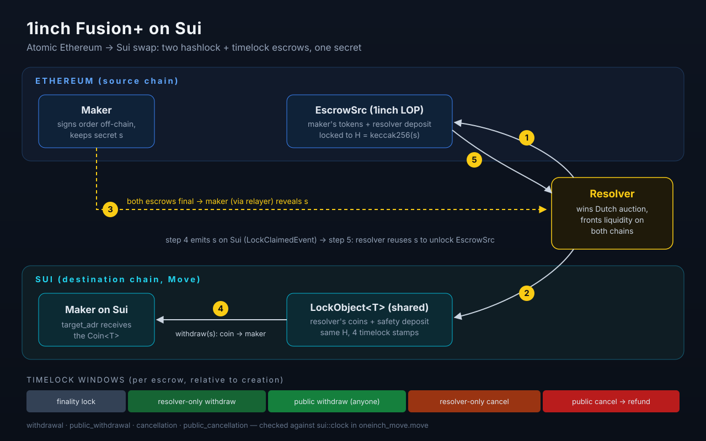
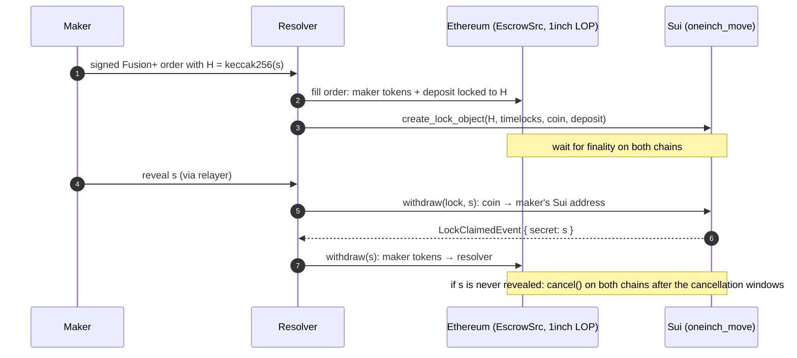

# 1inch Fusion+ on Sui (Move escrows)

The Sui side of a **1inch Fusion+ cross-chain swap**, written in Sui Move for ETHGlobal Unite (July–August 2025).
It gives Sui the same hashlock + timelock escrow that 1inch uses on EVM chains, so that an Ethereum ↔ Sui swap
can settle atomically: either both sides get paid, or both sides are refunded.



- `oneinch_move::oneinch_move`: one escrow (`LockObject<T>`), filled all at once. This is the module that the team's TypeScript resolver calls on testnet.
- `oneinch_move::partial_fills`: the same escrow, but several resolvers can each take part of it.
- 19 Move unit tests, all passing (`sui move test`).

---

## 1. What is a Fusion+ cross-chain swap? (from first principles)

**The problem.** Alice has USDC on Ethereum and wants SUI on Sui. No single contract can see both chains,
so nobody can write "send A *if and only if* B was sent" as one transaction. Either side could take the money and leave.

**The building block: an HTLC (hash time-locked contract).** An HTLC is an escrow with two locks:

| Lock | What it says |
|---|---|
| **Hashlock** | "Whoever shows a secret `s` with `keccak256(s) == H` can withdraw." Only `H` is published at first; `s` stays private. |
| **Timelock** | "If nobody withdraws before time `T`, the funds go back to whoever deposited them." |

Put **the same `H` on both chains** and the swap becomes atomic. The secret `s` has to be shown to open the first
escrow, and showing it on-chain makes it public. Anyone can then copy it and open the second escrow. If the secret is
never shown, both timelocks run out and both deposits are refunded.

**What 1inch Fusion+ adds on top:**

- **Resolver.** Alice does not run the swap herself. She signs an off-chain order, and professional *resolvers*
  bid for it in a Dutch auction (the price gets better for resolvers over time until one of them takes it).
  The winning resolver puts up the liquidity on both chains:
  - Alice's tokens go into `EscrowSrc` on Ethereum, through the 1inch Limit Order Protocol.
  - The resolver's own tokens go into the destination escrow, which here is Sui.
- **Safety deposit.** The resolver also locks a small extra amount in each escrow. It is paid to whoever
  actually calls withdraw or cancel. So if the resolver stops working, a third party is paid to finish the swap.
- **Secret reveal by the maker.** Once both escrows are final on their chains, Alice (through the 1inch relayer)
  gives `s` to the resolver. The resolver uses it to pay Alice on Sui, which publishes `s`, and then uses the same
  `s` to unlock Alice's tokens on Ethereum.
- **Staged timelocks.** Every escrow has a sequence of windows instead of one deadline `T`:

```
created ──► withdrawal ──► public_withdrawal ──► cancellation ──► public_cancellation
  finality   resolver-only    anyone with s        resolver-only     anyone can cancel
  lock       withdraw         can withdraw         cancel            → refund
```

## 2. How this repo ports it to Sui Move

On EVM, an escrow is a small contract deployed by a factory. On Sui there are no contract instances. Instead, an escrow
is a **shared object**, `LockObject<T>`, which holds the coins and the timelock timestamps, and the package's
functions act on it:

| Function | Who calls it | Checks |
|---|---|---|
| `create_lock_object<T>(clock, withdrawal_ms, public_withdrawal_ms, cancellation_ms, public_cancellation_ms, hashed, refund, target, secret_length, amount, deposit)` | resolver | Turns the durations into absolute `sui::clock` timestamps, shares the object and emits `NewLockEvent`. |
| `withdraw<T>(lock, clock, secret)` | resolver, or anyone in the public window | `now >= withdrawal`. Before `public_withdrawal` the sender must be the initiator. Also checks `len(secret)` and `keccak256(secret) == hashed`. The coin goes to `target`, the deposit goes to the caller, the object is deleted, and `LockClaimedEvent { secret }` is emitted. |
| `cancel<T>(lock, clock)` | resolver, or anyone in the public window | `now >= cancellation`. Before `public_cancellation` the sender must be the initiator. The coin goes to `refund` and the deposit goes to the caller. |

The hashlock uses **keccak256** (`sui::hash::keccak256`). That is the hash the EVM side uses, so a single `H` works
on both chains.

`partial_fills` keeps the same windows and adds the following:

- **`remaining_amount`** and **`withdrawPartial(amount)`**, so several resolvers can each take a slice of the escrow.
- A shared **`UsedSecretsRegistry`** that records which secret hashes have already been used.
- An `ethereum_order_hash` field on the object and on its events, so the off-chain resolver can link the Sui escrow
  to the 1inch order on Ethereum.

### Ethereum → Sui flow



### Layout

```
Oneinch_Move/
  sources/oneinch_move.move           single-fill HTLC (used by the team resolver)
  sources/oneinch_partial_fills.move  partial-fill variant + UsedSecretsRegistry
  tests/tests.move                    11 tests: timelock windows, wrong secret, wrong length, cancel rules
  tests/pf_test.move                  8 tests: partial fills, overfill, zero fill, cancel after fill, resolver race
```

## 3. Relationship to the team resolver repo

This repo contains **only the Move package**. The rest of the hackathon project lives in
[stylus-bataille/sui-cross-chain-resolver](https://github.com/stylus-bataille/sui-cross-chain-resolver), which is a fork of
[1inch/cross-chain-resolver-example](https://github.com/1inch/cross-chain-resolver-example). It contains:

- the Solidity `Resolver` and escrow factory, tested with Foundry against a Sepolia fork;
- `tests/sui-contract-bridge.ts`, which uses `@mysten/sui` to call `oneinch_move::create_lock_object`, `withdraw` and `cancel` on Sui testnet;
- Jest end-to-end specs (`ethereum-to-sui`, `sui-to-eth`, `main-sui-eth`) and a mock 1inch API backend. The mock exists
  because the official SDK rejects chain IDs it does not know about, and Sui is one of them.

**Who did what** (from git authors in both repos):

| Person | This repo (Move) | Team resolver repo |
|---|---|---|
| Alex Huou (`ahuou`) | Repo setup; HTLC module (`RAAAH`, Fusion+ timelock windows); test suite (`tests.move`); keccak256 hashlock | ERC20 support |
| Dearop | Move package scaffold; `public` API; partial-fills module and its first tests | Sui cancel/withdraw bridge, Sui → Ethereum flow, chain-ID fixes |
| Loris Tran (`ltran` / `Loris-EPFL`) | none | EVM contracts and Sepolia deploy scripts, mock 1inch API, Ethereum ↔ Sui Jest specs (ETH → Sui passing) |

The upstream 1inch example code was written by 1inch engineers (Vladimir Borovik, Radik Harutyunyan).

## 4. Build and test

You need the [Sui CLI](https://docs.sui.io/guides/developer/getting-started/sui-install). These steps were checked with `sui 1.81.1`.

```bash
cd Oneinch_Move
sui move build
sui move test
```

The package uses Sui's implicit framework dependencies (`Sui` and `MoveStdlib` come bundled with the CLI), so
building does not need to clone the whole Sui git repo.

## 5. Status (honest)

- **Works:**
  - Both modules compile, and all 19 unit tests pass.
  - The single-fill module is what the team's TypeScript bridge called on Sui testnet during the hackathon.
- **Hackathon-grade, not audited:**
  - There is no check that the timelock durations are ordered (`withdrawal < public_withdrawal < cancellation < …`).
    The caller is trusted to pass them in the right order.
  - Partial fills reuse **one** secret for every fill. Real Fusion+ partial fills use a Merkle tree of N+1 secrets,
    so that revealing the secret for one fill does not unlock the rest of the escrow.
  - `withdrawPartial` pays the fill to the caller, not to `target_adr`.
  - Filled partial-fill objects are kept, marked as filled, instead of being deleted.
  - `UsedSecretsRegistry` is a vector with linear lookup.
- **Fixed during the 2026 cleanup:**
  - The last hackathon commits ("Local CLI bug", "CLI issues continue") had left the package unbuildable. Three
    things were broken:
    1. `std::hash::keccak256` does not exist.
    2. The `create_lock_object` argument order had drifted away from both the tests and the TypeScript bridge.
    3. The partial-fill tests targeted an older API.
  - What changed:
    - The hash now uses `sui::hash::keccak256`.
    - The bridge's argument order is restored.
    - The partial-fill tests were rewritten against the current module.
    - The committed `build/` directory was removed.
- **Not done:**
  - No Sui → EVM resolver logic on chain.
  - No relayer integration on the Sui side.
  - No mainnet deployment.

> Warning (from the module docs): an HTLC cannot tell whether a `Coin<T>` is regulated or freezable, and it cannot
> tell whether the counterparty hashes the secret the same way. Both have to be checked off-chain before taking part in a swap.
